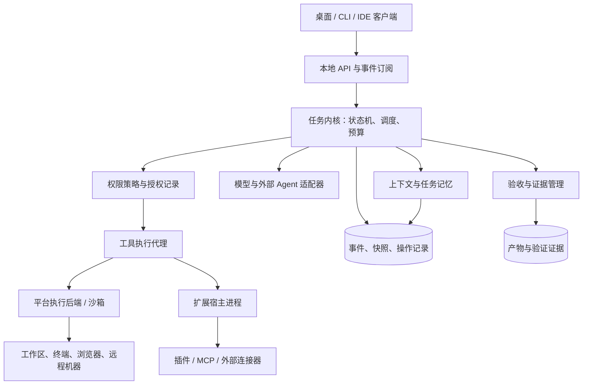
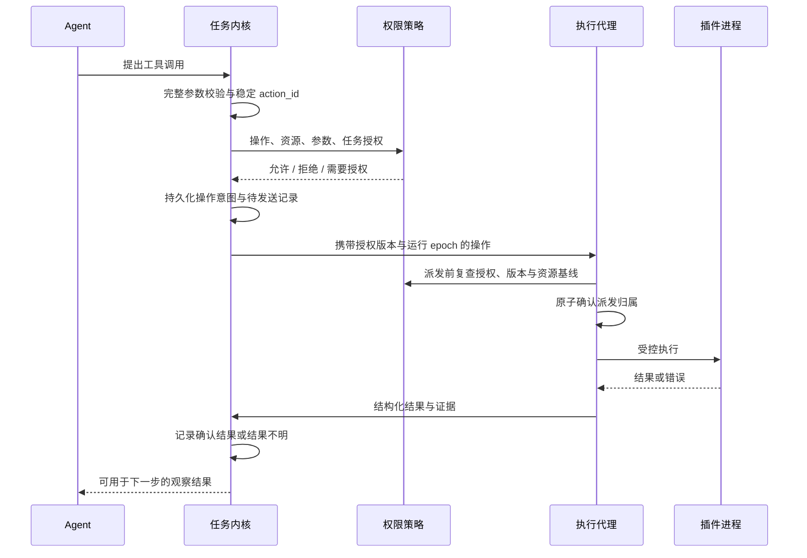

# CodeStudio-Agent：Agent 与 Harness 市场研究及产品架构

**报告日期：2026 年 10 月 21 日（Asia/Shanghai）**  
**研究范围：开发者与编码 Agent 为主，兼顾通用任务执行；依据本次可访问的官方文档、官方仓库与标准/编译器资料。**

本报告中的“主流”指具有代表性的商业产品与活跃生态，不是市场份额排名。产品能力是文档核实结果；“痛点”“机会”“推荐架构”是基于这些能力边界的分析，未经统一实机横评或用户调查验证。文档可能滚动更新，具体账户、版本、区域和部署方式仍会影响可用能力。

**产品正式命名为 CodeStudio-Agent。** 当前已落地 C++26 + XMake 的 0.1.0 CLI 基础版本，包括 Chat Completions、OpenAI Responses、Anthropic Messages 的流式/非流式接口、离线演示、权限控制、文件/进程工具、SQLite 任务记录、显式授权的 MCP stdio 插件、本地模型列表/能力探测，以及检查点驱动的显式任务续跑。已实现本地 stdio JSON-RPC 任务服务，提供查询、事件订阅/重放、流式文本与启动/取消/续跑，供后续桌面客户端复用。Windows LPAC 子进程隔离的范围为无网络 capabilities、单 executable 暂存和私有 scratch；默认仍为 `none`，动态验证结果见 [验证记录](docs/validation.md)，详细限制见 [沙箱说明](docs/sandbox.md)。本地模型后续工作已暂停。本文描述的完整插件生态、受控工作区沙箱与资源配额、桌面 UI、后台自动续跑、独立验收与多代理架构属于后续目标；已实现范围与运行方法见 [README](README.md)，实施依赖见 [开发路线](docs/roadmap.md)。

## 一、我的判断

如果现在从零设计一款 Agent，我会把产品定位为：**面向真实工程任务、可以持续工作、可恢复、可验证、能控制外部操作的开发工作台与运行时。**

其核心承诺应是：用户交给它一个任务，可以看清当前进展、授权范围、已产生的改动、验证证据和剩余成本；中途断网、进程崩溃或切换模型后，系统仍能说明哪些工作已经完成、哪些操作结果不明、接下来怎样安全继续。

我优先解决五个问题：

1. **任务连续性**：恢复工作状态、证据与未完成事项，避免只恢复聊天文本。
2. **交付可信度**：把需求、修改、测试和交付物关联起来，防止“模型说完成”直接变成“任务完成”。
3. **权限与操作可靠性**：授权持续有效、范围清楚；中断后不盲目重发部署、支付、发布等外部操作。
4. **模型与工具可替换**：保留供应商特长，同时让用户拥有可迁移的任务记录。
5. **插件生态可维护**：扩展有版本、权限、资源预算、崩溃隔离和升级回退机制。

**已确定的技术选型：C++26 + XMake。** 核心运行时采用 C++26，界面可采用 TypeScript/React，插件通过进程协议保持多语言开放。逐项确认编译器和标准库支持，对必要特性在配置阶段检查并明确失败；可选特性使用开关和替代实现。未来随着 mcpp 生态发展完善，再评估迁移范围与收益。以下语言比较保留为取舍依据，不再把 Rust 作为本项目的默认实现。

## 二、先区分 Agent、Harness、框架和协议

这些术语没有完全统一的行业边界。本报告采用以下工作定义：

| 层次 | 含义 | 典型职责 |
|---|---|---|
| 模型 | 生成判断、文本和工具调用请求的推理组件 | 理解、规划、生成、选择下一步 |
| Agent | 围绕目标观察环境、采取行动、根据结果调整的执行实体 | 分析任务、调用工具、验证和迭代 |
| Harness | 包围模型并让 Agent 实际工作的运行系统 | 循环、上下文、工具、执行环境、权限、状态、恢复、预算、评估 |
| 编排框架 / SDK | 帮助开发者构建上述系统的积木 | 图编排、会话、工具封装、追踪、多代理通信 |
| 协议 | 不同组件之间交换消息与能力的规则 | MCP、A2A、ACP、AG-UI 等 |
| Agent 产品 | 用户实际使用的完整软件 | 编辑器、CLI、桌面端、云端工作区、团队协作与计费 |

因此，Claude Code、Codex、Cursor 与 LangGraph 并不是同一层面的竞争者；MCP 也不能直接替代一个 Harness。同一产品可以包含多个 Agent、一个或多个 Harness，并使用多种协议。

一个实用表达是：

> Agent 的实际表现 = 模型能力 × 提供的上下文 × 工具与环境质量 × 执行与验证机制。

这里的乘号是强调短板效应的比喻，不是经过测量的数学公式。提高模型能力不自动解决进程管理、外部操作重复、权限越界或恢复一致性。

## 三、当前代表性 Agent 产品

### 3.1 开发者与编码 Agent

下表以本次读取的官方页面为准。最后一列同时包含厂商明确限制和本报告建议关注的选型边界，不是统一环境下的测评成绩。

| 产品 | 主要定位与已公开能力 | 主要边界、痛点或选型关注点 |
|---|---|---|
| **OpenAI Codex** | CLI、IDE、桌面和云端；本地读写与命令、会话恢复、子代理、MCP；插件可封装 skills、MCP、浏览器扩展与 hooks。[A1][A2][A3] | 插件能力随入口变化，当前文档明确 IDE extension 不支持插件。审批与 OS 沙箱是独立机制；不能由某一入口的能力推导所有入口等价。 |
| **Claude Code** | 终端、IDE、桌面、Web；文件/命令/Git、记忆、skills、hooks、MCP、子代理与 Agent SDK。[A4][A6] | checkpoint 不追踪 Bash 修改，也有子代理与外部修改范围限制。插件带来上下文、进程和权限成本；需要理解真正覆盖的执行边界。[A5] |
| **Cursor Agent / Cloud Agents** | 编辑器内开发与云端委派；当前 Cloud Agents 已有隔离 VM、多仓库、浏览器/桌面操作、截图/视频/日志证据。[A7][A8] | 本地 checkpoint 恢复文件，不删除会话消息；云端环境、凭据、网络和 hooks 与本地不完全一致。证据展示已经存在，新产品应进一步做好证据与验收项的关联。 |
| **GitHub Copilot** | IDE/CLI 等入口以及 GitHub Cloud Agent；研究、计划、后台修改、测试、PR、custom agents、MCP、hooks。[A9] | 本次 Cloud Agent 文档限定单次一个仓库、分支、PR，最长 59 分钟，仅支持 GitHub 托管仓库。这些限制仅指该云端入口。 |
| **Gemini CLI** | 终端 Agent；extensions、skills、MCP、hooks、checkpoint、独立上下文子代理、多种沙箱后端。[A10][A11][A12] | 各平台沙箱不等价；容器需要相应环境；浏览器子代理和认证方式存在具体限制。不能把目录里列出的能力都视为同一成熟度。 |
| **Google Antigravity** | 当前官方概览已包含桌面控制中心、CLI、IDE 与 Python SDK，支持交互开发和异步多代理工作。[A13] | 概览不能证明恢复语义、隔离强度和长期任务成功率；这些需要实机验证。 |
| **Devin** | 可委派的软件工程任务；写/运行/测试代码、浏览器、IDE、API、迁移与工单处理；终端任务可移交云端。[A14] | 任务可验证程度、环境准备和复杂任务拆分直接影响效果；厂商经验性能力宣传不作为横评结果。 |
| **Windsurf / Cascade** | 原 Windsurf Cascade 官方文档当前重定向到 Devin Desktop；保留本地编码、规划、MCP、memory/rules、workflows、checkpoint 等能力。[A15] | 官方明确同文件并发编辑会竞争，建议 worktree；当前 checkpoint revert 不可逆。文档归属变化不用于推断全部商业整合关系。 |
| **OpenHands / Agent Canvas** | 当前主仓已定位为开放的 Agent 控制中心；本地、远程、云后端与自动化，可接入自身及 ACP 第三方 Agent。[A16] | 每会话容器不代表全部控制组件被隔离；不同容器挂载同一宿主工作区仍会发生文件冲突。 |
| **Cline** | 当前已覆盖编辑器、CLI、桌面及 SDK 等入口，支持 MCP、工具执行与按类别 Auto Approve。[A22][A23] | 不能再概括为“每一步强制手动批准”。其 safe command 分类依赖模型标记，不能等同于 OS 沙箱或固定命令白名单。 |
| **OpenCode 2** | 开源、多提供商、CLI/桌面/Web、插件与 MCP。[A17][A18] | 需要区分 V1/V2 文档和迁移行为；多提供商接入不自动保证上下文、工具和恢复行为一致。 |
| **Qwen Code** | 当前官方 README 已包括多协议、多端、SubAgents/Agent Teams、记忆、skills、MCP 与多语言 SDK。[A19] | Web UI/daemon 有实验标记；厂商 feature parity 和 benchmark 不作为独立领先证据。 |
| **Kimi Code CLI** | 当前新版支持代码、命令、网页、插件、MCP、子代理、hooks 与 ACP；旧 Python CLI 已归档替换。[A20][A21] | 迁移不保留全部凭据、MCP 授权和旧插件；当前新版 Windows 依赖 Git Bash。版本迁移成本是实际产品问题。 |

### 3.2 个人助手与业务流程平台

如果目标超出编程，还应关注以下不同形态。它们扩大了 Agent 的应用场景，但不能简单与编码产品做同一张成功率排行榜。

| 代表 | 公开定位 | 对新产品的启示与边界 |
|---|---|---|
| **OpenClaw** | 本地 Gateway 管理会话、工具、事件与消息渠道；模型和 Harness 可以通过插件替换，状态与记忆保存在用户设备。[G1] | “本地控制平面 + 多渠道 + 可替换 Harness”已有实现。官方明确主会话工具默认运行在宿主上，除非配置沙箱；本地保存也不等于模型请求不会发往所选云服务。 |
| **Hermes Agent** | 强调持久记忆、经验生成 skills、历史会话检索、子代理、多模型与本地/SSH/容器等执行后端。[G2] | 值得借鉴个人化与经验复用；“自我改进”的宣传应拆成可评测的检索、技能生成与回归表现，防止错误经验永久累积。 |
| **Dify** | 可视化 LLM 应用、workflow、RAG、Agent、模型管理与观测；当前 README 也描述有沙箱的自主 Agent。[G3] | 适合业务应用交付；复杂工程状态恢复与本地开发体验需要另行判断。采用源码时需注意其附加许可条件。 |
| **n8n** | AI Agent 与业务工作流自动化，提供连接器、人工确认、可视化流程、自托管及云服务。[G4] | 擅长与现有业务系统连接；具体副作用幂等和补偿仍需业务设计。其 fair-code/Sustainable Use License 不应笼统等同于无条件宽松开源许可。 |

**市场判断：** 多入口、插件、记忆、子代理、云端执行和模型可替换都已有成熟或正在发展的实现。新产品应选择一个可以测量的突破口，例如“长工程任务的恢复成功率与人工接管时间”，用真实对比证明价值。

## 四、主要 Harness、SDK 与编排框架

| 代表 | 负责哪一层 | 适合什么 | 需要补齐或核验什么 |
|---|---|---|---|
| **OpenAI Agents SDK** | 应用内 agent loop、tools、handoffs、agents-as-tools、guardrails、sessions 与 tracing。[H1] | 把 Agent 嵌入自己的业务应用，定制工具和控制流 | 不等同于托管 Codex Harness；应用负责部署、会话存储、工具环境、审批和沙箱，不能假设自动继承 Codex 的执行机制。 |
| **Claude Agent SDK** | 将 Claude Code 的 loop、内置工具、上下文管理、权限、会话与扩展机制提供给 Python/TypeScript 应用。[H2] | 快速构建文件/终端/代码密集型 Agent | 要接受底层 binary 与供应商语义；文件 checkpoint、shell sandbox、MCP 和 hooks 的覆盖边界不同。[H3][H4] |
| **LangChain** | 模型、工具、middleware 与常用 Agent loop 集成。[H5] | 快速组合模型和工具 | 抽象集成不能替代执行隔离、业务状态和副作用治理。 |
| **LangGraph** | 有状态、长时间运行的编排 runtime，支持 persistence、interrupt、streaming 等。[H6] | 显式流程、人工介入、持久化与恢复 | durability 有不同模式；恢复可能重跑节点，开发者必须设计幂等和非确定性工作边界。[H7][H8] |
| **Deep Agents** | 在 LangGraph/LangChain 基础上提供更完整的文件、上下文、子代理等 Harness。[H9] | 希望获得现成深任务结构，同时保留自定义空间 | 子代理上下文隔离不是 OS 隔离；执行环境和 sandbox backend 仍须配置。 |
| **Microsoft Agent Framework** | Agent 与显式 workflow、会话、middleware、观测及集成。[H10] | .NET/Microsoft 生态及企业工作流，也可按其支持语言构建应用 | 官方明确它是 AutoGen 与 Semantic Kernel 的直接继任者；新项目应连同迁移路线一起评估，而不是把三个名字当无关的新框架。 |
| **Google ADK** | Agent、工作流、session/event/state、工具、运行时、观测与评估。[H11] | Google 生态及希望使用框架构建多代理应用的团队 | 功能依语言和部署组合而异。当前 action confirmation 文档仍有 experimental 标记，并列出与部分持久化 session 服务不兼容的限制。[H12] |
| **OpenHands Software Agent SDK** | Coding Agent 的 Python/REST SDK、workspace、Agent Server、工具与会话保存。[H13] | 自建开放的编码 Agent 与执行服务 | 会话持久化、工作区快照、容器和外部系统状态仍需分别管理。 |

这些体系可以作为新产品的一部分，无须全部重写。对于本报告建议的“原生桌面任务内核”，可将 Python/TypeScript 框架作为受控执行后端；对于纯云端业务应用，直接以现成框架作为主运行时往往更经济。

一个实际案例是 LangGraph：同步 checkpoint 能减小进程退出造成的状态丢失窗口，但 `interrupt()` 恢复仍会重新运行所在节点；放在中断前的副作用必须处理重复执行。[H7][H8] **支持某功能，与多种功能组合后能可靠工作，是两项需要分别验证的事情。**

## 五、真正值得解决的痛点

以下是架构层面的共性风险，不意味着表中每个产品都有同样的问题，更不意味着它们完全没有应对机制。

| 痛点 | 用户看到的现象 | 根因或边界 | 新产品需要提供的能力 |
|---|---|---|---|
| 长任务失去连续性 | 换一轮后重复调查、忘记约束、半成品无人接手 | 聊天摘要不能完整表达执行状态；上下文被无关内容挤占 | 结构化任务状态、来源明确的记忆、恢复检查 |
| 完成判断不可靠 | 文件生成了，但流程跑不通；测试没覆盖真实需求 | 生成者自评偏宽松，测试与需求脱节 | 需求—改动—验证证据映射；重要任务独立检查 |
| 恢复不等于回滚 | checkpoint 恢复后，命令产生的改动或外部发布仍存在 | 会话、文件、进程和外部系统是不同状态域 | 明确恢复覆盖范围，记录副作用，查询实际结果 |
| 权限过粗或反复确认 | 同类操作一直询问，或一次放开整个 shell | 缺少可持续、可撤销、绑定资源的授权 | 任务级授权和执行前策略判定 |
| 兼容接口不等于行为一致 | 换供应商后工具、推理项目、压缩或恢复出错 | 流式事件、缓存、工具语义、会话格式不同 | 能力协商、原生适配、显式降级 |
| 插件接得上却管不住 | 某个 MCP/插件读取过多文件，卡死或带出凭据 | 协议连接与 OS 隔离、权限治理混在一起 | 独立扩展宿主、操作代理、资源限制 |
| 多代理制造协作成本 | 同改一个文件、相互等待、重复阅读和验证 | 工作拆分、共享状态与写入归属不清 | 默认单代理，按证据启用并行；隔离写入与集成 |
| 成本和延迟不可预测 | 简单任务研究过度，困难任务无限重试 | 缺少停止规则、分阶段预算和效果评价 | 预算预留、重复失败检测、效果与成本同时衡量 |
| 本地环境适配不足 | Windows 路径、终端编码、子进程、凭据或 WSL 行为不一致 | 把某种 shell 或平台当成通用执行模型 | 平台原生执行后端与跨平台一致的工具契约 |

这些问题有公开研究依据。例如，Anthropic 的长任务实验记录了过早宣布完成、留下半成品、跨上下文丢失进度和缺少端到端测试等失败模式；上下文工程文章说明了压缩和结构化笔记的用途与局限。[D1][D2]

同样需要看到能力在进步。Anthropic 后续 Harness 实验发现，模型升级后，原来有效的一些任务切分和评审步骤会变成成本负担；评审代理是否有价值，取决于任务是否超出了当前模型独立完成的能力范围。[D3] 因而，**权限、状态与进程管理应稳定存在；为了补偿模型不足而添加的复杂编排，应可以通过实验删掉。**

## 六、我会如何定义新产品

### 6.1 首批用户与任务

先服务需要跨文件、跨工具、持续数十分钟到数小时工作的开发者与小团队。首批场景选择：

- 根据明确需求修改已有项目，并给出可审查的补丁和验证证据。
- 复现问题、定位原因、修复并重新验证。
- 执行依赖升级、代码迁移、构建与打包等步骤明确但容易中断的任务。
- 在同一个工作台使用不同模型和现有 Agent，并保留任务资产。

通用办公、浏览器操作、数据分析可以通过扩展逐步加入。首版不同时追求完整 IDE 替代、通用自动办公平台和企业流程引擎。

### 6.2 用户界面应展示的核心对象

工作台至少应有：任务与验收条件、当前阶段与等待原因、修改与交付物、验证结果、授权范围、预算消耗、时间线。

对用户来说，“正在做什么、为什么停住、哪些已完成、还有什么风险”比看到每条内部工具日志更重要。详细日志可展开查看；供应商错误应转换成明确的恢复选项，而不是把原始协议对象直接推给用户。

### 6.3 可形成差异的三项承诺

1. **恢复可解释**：给出恢复点、覆盖的状态域、需要重新核对的外部操作。
2. **交付有证据**：每个关键验收条件都能打开对应的检查结果与产物。
3. **迁移有边界**：明确哪些任务资产可跨模型迁移，哪些只能在原 Harness/供应商中继续。

这些承诺需要与现有产品实测比较。它们是建议的竞争方向，不能仅靠功能列表就认定为已验证的市场空白。

## 七、整体架构：一个核心服务，多个受控执行边界

首版采用模块化单体核心服务，配合按需启动的执行进程。无需为了“Agent 平台”预先建立大量微服务。



模型只能提出操作请求；**真正的执行权掌握在策略判定与工具执行代理手中**。远端工具或第三方 Agent 若有独立执行通道，就必须单独说明其控制边界，不能在图中经过一个模块便宣称已经完全受控。

### 7.1 核心模块及其边界

| 模块 | 对外提供什么 | 不应承担什么 |
|---|---|---|
| Task Kernel | 创建、推进、暂停、取消、恢复任务；调度子任务 | 直接拼 shell 命令、直接读取全局密钥 |
| Session Store | 事件序列、快照、工具结果、授权与版本信息 | 把一份摘要当成全部事实 |
| Model Gateway | 流式生成、工具调用、用量统计、能力协商 | 假装所有供应商行为相同 |
| Context Service | 按当前目标组装上下文、索引与溯源 | 无限制向模型塞入全部历史 |
| Policy Engine | 根据用户授权、组织规则、资源范围判定操作 | 根据模型的“安全声明”放行 |
| Execution Broker | 校验参数、操作登记、启动执行、处理超时与结果 | 隐式执行插件请求的任意动作 |
| Supervisor | 进程树、取消、资源限制、心跳、崩溃处理 | 将进程终止当成外部操作撤销 |
| Plugin Host | 加载、协商、调用、升级与隔离扩展 | 允许插件修改核心授权或读取内核内存 |
| Verification Service | 管理验收条件、检查证据、结论与未覆盖项 | 仅依赖生成模型对自己的评价 |

本地状态可先用 SQLite，产物进入内容寻址的文件存储；远程协作出现真实需求后，再引入服务端数据库、对象存储和调度队列。内容哈希用于识别版本与去重，本身不证明内容来源可信。

### 7.2 任务状态与操作状态必须分开

任务可以经历：

```text
Created → Ready → Running → Verifying → Succeeded
                    ↕           ↓
                 Waiting      Running（修正后重验）

Running / Verifying → Paused / Failed / Cancelling → Cancelled
```

`Waiting` 必须带原因，例如等待用户信息、授权、外部作业或速率限制。工具是否已执行，则由独立的操作状态记录：

```text
Proposed → Authorized → Prepared → Dispatched
                                      ├→ ConfirmedSuccess
                                      ├→ ConfirmedFailure
                                      └→ OutcomeUnknown → Reconciled / NeedsAttention
```

`OutcomeUnknown` 很重要：请求可能已经被远端执行，但本地没有收到响应。它既不是“失败”，也不应自动重试。

最少持久化以下对象：

| 对象 | 关键字段 |
|---|---|
| Task | 目标、验收条件、约束、父子关系、状态、预算 |
| Run | 模型/供应商、Harness 版本、执行环境、会话关联 |
| Event | 单调序号、事件类型、发生时间、关联 ID、脱敏载荷 |
| Action | 稳定 action_id、规范化参数摘要、资源版本、授权、结果状态 |
| Artifact | 文件或对象引用、内容哈希、来源、所属任务 |
| Evidence | 验收项、检查方法、运行环境、退出码、日志/截图/产物引用 |
| Grant | 操作类别、资源范围、有效期、发放依据、撤销状态 |

快照用于加快读取，事件用于重建已记录的状态。外部响应、模型输出和关键环境版本需要被引用或记录，否则不能声称“可复现”。

同时建立三项约束：第一，每个任务只有一个有效的活动运行身份，使用租约与递增 execution epoch 隔离旧 worker；过期运行的晚到结果不能触发新动作，恢复先处理旧运行的在途操作。第二，事件、快照与工具结果各有 schema 版本和兼容迁移规则，升级前验证旧任务样本；不兼容时安全拒绝恢复。第三，日志在落盘前脱敏，敏感内容按策略加密、限期保留和删除，不能以可复现为由永久保存所有凭据与原始输入。

### 7.3 正确恢复需要处理外部副作用

本地数据库事务可以让“记录动作意图”和“加入待发送队列”一致提交，但无法与任意第三方 API 组成一个通用的原子事务。因此，不承诺跨所有工具的 exactly-once。

执行结果与效果状态也要分开：脚本退出失败可能已经改了部分文件，响应解析失败也可能发生在远端成功之后。`ConfirmedFailure` 只说明执行层确认失败，不证明“完全没有副作用”；另行记录 `none / partial / applied / unknown` 等效果状态。只有能确认没有效果或具有安全幂等语义时，才能自动重试。服务端的幂等键记录与资源变更还需要原子性，AWS 的官方实践明确说明了这一点。[H14]

建议按工具声明的实际语义处理：

| 操作类别 | 例子 | 中断后的策略 |
|---|---|---|
| 可重做读取 | 读取文件、查询作业状态 | 可重试，同时记录读取对象的新版本 |
| 有幂等支持的写入 | 支持幂等键的 API | 重用同一 action_id 对应的幂等键，遵守服务端去重范围和有效期 |
| 可查询结果的写入 | 创建 PR、触发构建 | 通过返回 ID、关联标识或查询条件核对，确认后再决定是否重试 |
| 可补偿操作 | 某些配置修改、草稿创建 | 用明确的补偿步骤恢复；补偿也可能失败 |
| 无法可靠判断的操作 | 不支持查询/去重的发布或外部操作 | 保留结果不明状态，让用户或运维核对 |

**事件回放**用于重建状态，默认不再次调用真实工具；**模型重跑**用于重新生成决策，可能得到不同输出；**环境回滚**需要文件、容器或远程系统提供单独机制。这三者必须在 API 和界面上明确区分。

取消同样需要分层：先停止产生新操作，再传播取消请求，随后终止可控制的进程树，最后核对已发出的外部请求。终止本地进程无法撤销已经发送的邮件或已经完成的部署。

### 7.4 工作区、进程与跨平台执行

写文件前保存基线与内容哈希，提交补丁前重新检查文件版本；用户或另一代理已经修改时，进入合并或冲突处理。多文件修改不能仅凭单文件原子重命名就宣称是全工作区事务。回退只处理本次任务拥有的改动，不能覆盖后来的人工作业。

验证证据绑定被验证的提交、工作区或产物摘要，同时记录命令、检查器与环境版本。后续修改使相关证据失效；进入 `Succeeded` 前，验收器检查当前候选版本与证据一致、关键验收项通过且关键操作没有未解决的结果不明状态。这样才能防止“测试过旧版本，却把新版本标成完成”。

并行编码优先使用独立 Git worktree，由集成阶段统一合并与验证。worktree 解决代码改动隔离，不提供文件系统权限或网络安全隔离。

执行后端根据平台实现：

- **Windows**：结构化进程参数、ConPTY 交互终端、Job Object 管理进程组；访问隔离需要另行设计 AppContainer/受限令牌/容器或虚拟机方案。Job Object 主要处理进程组和限制，不是完整安全沙箱。[D4][D5]
- **Linux**：按场景组合进程组、资源控制、命名空间、系统调用限制和文件访问策略；高风险任务采用更强隔离边界。
- **macOS**：实现并验证平台可用的权限隔离方案；对不能可靠限制的执行使用隔离工作环境或虚拟机，不假设与 Linux 使用相同机制。

每个后端都报告实际保证级别。无法提供要求的隔离时，应阻止该高权限操作或明确请求降级，不能悄悄变成宿主机全权限执行。

## 八、上下文、模型适配与多 Agent

### 8.1 上下文是一份按需构建的输入

每轮输入由稳定指令、用户约束、当前任务状态、相关证据和少量必要历史构成。详细日志、完整文件和过期工具输出保持在外部，按路径、哈希或查询引用重新读取。

记忆分为四层：当前运行的短期状态、项目事实、任务经验、用户明确希望长期保留的偏好。每条持久记忆附来源、时间、适用范围、置信状态和失效条件；允许查看、更正、删除和导出。模型自己总结的推测不应自动成为永久事实。

压缩前保留可追溯的原始证据引用，并检查用户约束、未完成事项、关键决策和验证结果是否遗漏。仓库文件、网页和工具输出属于外部数据，其中出现的指令不能自动获得系统权限。

### 8.2 模型适配器保留差异

通用接口提供流式事件、工具调用、结构化输出、取消、用量和能力描述；具体适配器处理供应商的缓存、服务端会话、压缩、文件引用等原生能力。

能力描述应能回答：是否支持某种输入、并行工具调用、输出约束、可恢复会话、缓存计费、工具结果大小限制等。不要用一个 `openai_compatible = true` 布尔值替代全部协商。

部分工具参数在流式传输中可能尚未完整。只有工具调用完成、结构校验通过且策略允许后才执行，不能把中间片段当成最终参数。

跨供应商迁移主要迁移**用户可见消息、任务状态、工具结果、产物、约束与证据**。供应商专属会话 ID、不透明/加密推理项目和模型内部状态不能假设可移植。切换后应重建可用上下文并核对环境，而不是承诺原样续接全部内部推理状态。

### 8.3 同时接入现有 Agent，但标明控制能力

产品可支持两种执行模式：

| 模式 | 特征 | 平台能承诺的边界 |
|---|---|---|
| 自有 Harness | 模型请求经过自己的工具、策略和状态系统 | 可实现完整的动作登记、权限判定和恢复逻辑 |
| 外部 Agent 适配 | 通过官方 SDK、CLI 或其支持的协议调用现成 Agent | 能力取决于其接口、hooks、沙箱和事件完整度 |

若外部 Agent 在自己的进程里直接执行工具，外层看到了文本日志并不代表能可靠拦截每项操作。需要在 OS/容器边界限制资源，或使用可审查的工具代理；仍不具备的能力在界面和任务记录中明确显示。

### 8.4 多 Agent 按任务启用

默认一个主代理，必要时启动研究、实现或评审子任务。独立资料调查、不同模块实现、只读审查适合并行；同一文件中的紧密修改通常不适合并行。

子任务应带目标、输入、可访问资源、写入归属、预算、截止条件和结构化交付格式。子代理不能自行扩大授权，其授权最多是父任务授权的子集。

评审代理不是质量保证的替代品。可运行的测试、浏览器检查和需求匹配应优先；只有额外审查能带来净收益时才增加评审代理。对同一问题连续失败达到阈值时，应改变方法、收集缺失信息或停止，而不是不断叠加代理。

## 九、插件系统：协议兼容与权限治理同时设计

### 9.1 插件应有哪些类型

| 扩展类型 | 用途 | 推荐执行形式 |
|---|---|---|
| Skill / Workflow | 领域说明、工作步骤、模板和资源 | 声明式包；包含的脚本仍进入执行策略 |
| Tool / Connector | Git、数据库、浏览器、业务系统 | 独立进程，或受控远端连接 |
| Model Provider | 新供应商、私有模型网关 | 独立适配进程或经过审核的内置适配器 |
| Language / Indexer | LSP、符号索引、代码分析 | 独立进程，允许复用现有生态 |
| Evaluator | 测试、规则检查、质量评分 | 受控检查进程，返回证据 |
| UI Extension | 专用面板、交互式审批或产物预览 | 隔离 WebView/受限消息通道 |

核心授权判断、授权记录和操作账本不允许普通插件替换。可以扩展政策规则，但只有拥有相应管理权的主体才能配置，且规则本身也要版本化和审计。

### 9.2 三种执行等级

1. **默认：独立进程插件。** 优先采用带明确消息边界的 JSON-RPC；用标准输入输出或受 ACL 保护的本地通道通信。需要远程流式和高吞吐时再评估 gRPC。插件可以用 TypeScript、Python、Go、Rust 或 C++ 实现。
2. **可选：Wasm 插件。** 适合解析、转换、规则检查等计算任务。通过明确导入的宿主接口获取能力，并配置执行时间、内存和输出限制。Wasmtime/WASI 的沙箱与能力模型有官方说明，但宿主函数、运行时漏洞和配置错误仍然影响安全。[D6]
3. **例外：可信原生模块。** 只给经过审计的内部热点使用；不把任意第三方 DLL/so/dylib 加载到核心进程。确需 ABI 边界时采用窄 C ABI、显式内存归属和版本化结构，不跨边界传 STL 容器、异常或 C++ 对象布局。

**独立进程提供崩溃隔离，不自动提供权限隔离。** 一个以用户身份运行的恶意插件，仍可能直接读取用户文件；必须配套 OS 沙箱、最小环境变量和网络控制。Wasm 插件也不能通过过于宽泛的宿主函数绕过这些约束。

### 9.3 一个建议的插件声明

以下是本产品拟定的示意格式，不是 MCP 或其他现有标准：

```json
{
  "id": "studio.git-review",
  "version": "1.2.0",
  "hostApi": ">=1.0 <2.0",
  "runtime": {
    "kind": "process",
    "entry": "bin/git-review-worker",
    "protocol": "studio-plugin-rpc/1"
  },
  "capabilities": {
    "workspaceRead": ["selected-workspace"],
    "workspaceWrite": [],
    "network": [],
    "secrets": []
  },
  "tools": [
    {
      "name": "review_diff",
      "inputSchema": "schemas/review-input.json",
      "outputSchema": "schemas/review-output.json",
      "effect": "read",
      "timeoutMs": 30000
    }
  ],
  "limits": {
    "concurrency": 2,
    "memoryMiB": 256,
    "maxOutputBytes": 1048576
  }
}
```

manifest 表达的是申请的能力，不能自行授予能力。`effect: read` 等声明必须通过实现审核、运行控制和测试约束，不能只相信插件自报；对于无法实施的限制，宿主必须明确拒绝或报告不支持。

### 9.4 每次工具执行的顺序



授权可按任务持续存在，不应每次都询问。授权绑定操作类别、资源、任务和必要的参数约束；参数、插件版本或资源风险发生实质变化时重新判定。显式撤销后，尚未派发的调用失效，已经派发的调用进入取消与结果核对流程。

排队期间授权可能变化，执行代理必须在真正派发前复查，并以原子状态迁移确定派发归属。文件路径检查还需处理符号链接、Windows reparse point 与检查后目标被替换的问题；能使用已校验的文件句柄或受限目录能力时，优先使用它们。

密钥由系统凭据库和受控凭据代理管理，插件仅拿到必要的短期凭据或代调用能力；模型上下文中不出现原始密钥。对必须持有令牌的插件，通过权限范围、有效期和运行隔离缩小影响。

### 9.5 生命周期与生态治理

插件支持安装、校验、能力协商、启用、运行、排空、升级、回退和卸载。包签名、哈希和来源记录用于验证分发完整性，不能证明代码本身无害。

项目可锁定插件版本、工具 schema 和权限策略，便于复现。升级先检查兼容性并备份状态，再迁移；活跃调用不被随意替换。插件状态迁移回退与已经发生的外部操作回退必须分别处理。

RPC 层还需要消息大小限制、超时、取消、心跳、背压、最大并发和异常输出隔离；日志不与协议消息混用。标准输出被插件日志污染、持续输出超大结果、断流和进程崩溃，都应有明确处理。

### 9.6 如何使用现有协议

把 MCP 用于工具与资源连接，把 A2A 用于适合的远端 Agent 协作，把 ACP 用于其覆盖的编辑器—Agent 接入，把 AG-UI 用于需要的交互事件流。它们解决的连接层不同，不能视作互换协议。

这里 ACP 专指 **Agent Client Protocol**，不要与其他同缩写协议混淆。不要同时从头实现全部协议。首版优先 MCP 与自有稳定执行接口；ACP、A2A 和 AG-UI 按实际集成需求加入。第三方协议进入系统后统一映射到内部动作、授权、预算与证据模型；协议本身不替平台完成所有治理。[H15][H16][H17][H18]

MCP 的工具 annotations、roots 或插件自报的 read-only 属性，也不能替代真正的文件权限和安全策略。[H19][H20] TypeScript 插件使用独立 Node 进程时，还要配套 OS 限制；Node 官方明确 `node:vm` 不是运行不可信代码的安全机制。[C12]

## 十、编程语言怎么选

语言选择首先看产品形态与团队经验，其次看测量到的瓶颈。Agent 的耗时可能主要来自模型推理、网络、构建和浏览器操作；把宿主改成 C++ 不会自动让模型更准确，也不一定明显缩短任务总耗时。

下面是工程选型判断，不是本次跑分结果：

| 语言 | 我会让它负责什么 | 主要价值 | 主要代价 |
|---|---|---|---|
| **Rust** | 本地 daemon、权限和进程代理、状态存储、文件/网络边界 | 原生资源控制、无 GC、safe Rust 的所有权约束适合长期运行核心 | 学习与异步所有权复杂度；unsafe、FFI 和授权逻辑仍需审查 |
| **Go** | 远程 runner、调度服务、云端控制面，也可做本地 daemon | 网络服务与并发开发方便，部署直接 | GC、原生库集成及桌面生态需要按目标衡量；取消是协作机制 |
| **TypeScript** | UI、IDE 扩展、插件 SDK、模型适配；也可做快速产品原型的控制面 | Web 和 Agent 集成生态、开发效率、协议共享 | 类型在运行时不能保护外部数据，仍需 schema 校验；JS 隔离必须独立设计 |
| **Python** | 评测、数据处理、模型工具、研究与业务 Agent | 模型和数据工具生态丰富，适合快速实验 | 环境分发、资源控制和并发需要设计；不必因此排除服务端生产使用 |
| **C++23 / C++26** | 原生宿主、本地索引/推理、资源敏感组件、现有 C/C++ 系统集成 | 系统 API 与本地计算集成直接，资源管理可精细控制 | 生命周期、内存与并发安全、构建矩阵、ABI 和依赖管理成本较高 |

### 10.1 本项目选定方案：C++26 核心

**C++26 任务内核 + 跨进程插件 + TypeScript 界面**。核心保持独立库与服务边界，CLI、桌面和 IDE 接入复用同一任务语义。原生 UI 需求强时，也可评估 Qt/QML；界面技术尚未确定，不预先维护两套。

核心会长期持有文件、进程和凭据相关权限，因此 C++ 方案要把所有权、生命周期、输入校验、Sanitizer 与模糊测试纳入日常开发。Rust 的所有权检查是另一种降低部分内存错误风险的方法，[C11] 本项目既然选择 C++26，就通过明确约束与工程验证承担相应责任。

采用 SQLite，以及一套成熟的网络/异步基础设施。可先使用 Asio 类事件循环配合协程，再用内部薄接口封装；`std::execution` 按实际工具链成熟度引入，不同时维护多套异步 runtime。

核心接口保持窄而稳定：`TaskScope` 管理生命周期/取消/预算，`EventStore` 管理持久化，`ToolBroker` 管理授权与执行，`ProviderAdapter` 管理供应商差异，`PluginHost` 管理进程协议。插件作者不必使用 C++，也不接触内部对象布局。

### 10.2 已确定的构建工具：XMake

**XMake 适合这个新建的 C++26 应用项目。** 它把目标定义、工具链选择、依赖管理和自定义构建规则集中到 Lua 配置中，可以作为核心、CLI、插件宿主和测试程序的统一构建入口。选择依据是项目自身的维护便利性，不是声称其在所有 C++ 项目里都优于 CMake。

本次核对 XMake **v3.1.2 发布标签源码**发现，`cxx26` 在 GCC 类后端映射为 `-std=c++26` 或 `-std=c++2c`；MSVC 后端尝试 `-std:c++26`，并可回退到 `-std:c++latest`。[X1][X2] 这说明构建系统能够表达 C++26 模式，不说明选中的编译器已经实现全部 C++26。

| 方面 | 判断与采用方式 |
|---|---|
| 工程配置 | 以一套 `xmake.lua` 定义目标和依赖；目录增多时拆分子配置，避免把业务与打包逻辑全部塞入根文件。 |
| 第三方依赖 | 使用 `add_requires` / `add_packages`，选择版本后开启根作用域的 `package.requires_lock`，提交生成的 `xmake-requires.lock`。[X3] |
| CMake 生态 | 可消费已安装的 CMake 包，也可通过包配方调用 CMake 构建源码依赖；第三方库无需全部改写成 XMake。[X4][X7] 复杂导出目标、交叉编译和特殊选项仍须逐库验证。 |
| 工具链 | 明确选择 MSVC、Clang/clang-cl 或 GCC，固定编译器、标准库、SDK 和依赖构建参数。[X5] Windows 下尤其要保持 CRT、架构、Debug/Release 与依赖一致。 |
| 编辑器 | 生成 `compile_commands.json` 接入 clangd 等工具；调试通过对应编辑器插件配置。编译数据库不能使旧版 clangd 理解其尚不支持的 C++26 语法。[X6] |
| Modules | 作为独立构建能力评估。普通头文件方案可以先交付；BMI 不能跨任意编译器/版本复用。构建系统支持 modules 不意味着反射、标准库和 IDE 支持同步成熟。 |
| 产品插件 | XMake 的 Lua 脚本用于构建；Agent 的运行时插件仍使用前文的进程协议和权限机制，二者职责分开。 |

#### 建议的最小配置形态

以下仅用于说明目标划分，源文件路径是假定布局；本次没有创建或编译工程骨架：

```lua
set_project("codestudio-agent")
set_languages("cxx26")
set_policy("package.requires_lock", true)
add_rules("mode.debug", "mode.release")

target("agent_core")
    set_kind("static")
    add_files("src/core/**.cpp")
    add_includedirs("include", {public = true})
target_end()

target("codestudio-agent")
    set_kind("binary")
    add_files("src/cli/**.cpp")
    add_deps("agent_core")
target_end()
```

需要额外补上项目真正依赖的 C++26 特性检查。必须使用的特性缺失时直接停止配置并说明原因；可选反射或异步后端才允许明确降级。不要仅设置 `cxxlatest`，也不要把“接受标准选项”当成特性测试。

#### 可重复构建要锁哪些东西

1. **XMake 本身**：开发与 CI 使用同一精确版本或经过验证的构建。`set_xmakever` 表达最低版本要求，不能替代 CI 工具安装版本的固定。
2. **工具链与 SDK**：记录编译器、标准库、Windows SDK/macOS SDK 或目标 sysroot，以及运行库选项。
3. **依赖**：提交 `xmake-requires.lock`；官方实现默认不启用此策略，启用后记录依赖版本与包仓库提交，并按平台/架构分段，需覆盖实际发布组合。[X8][X9] 同平台的多种工具链/配置仍需分别验证，不能只看某个平台条目存在。系统库、外部包管理器和自定义下载另外固定，不由一份锁文件推导完全可重复构建。
4. **配置与生成步骤**：记录编译选项、生成器版本和输入；工具链或 modules 选项改变后，不复用不兼容的构建缓存。

本机只读检查得到 **XMake `v3.0.8+dev.1e431c685`**，且可定位 MSVC、Clang 和 GCC。这里只证明工具可发现及 XMake 能启动，没有验证任一工具链完整编译本项目或 C++26 特性。当前为开发构建版本，正式 CI 应固定通过验证的精确版本，避免随本机更新漂移。

**已确定：C++26 为主语言，XMake 作为当前唯一手写的原生项目构建入口；按需保留第三方依赖内部的 CMake 构建。** 若界面采用 TypeScript，则由其前端工具链处理，可以由统一任务入口协调。

### 10.3 长期候选方向：mcpp

根据用户决策，**随着 mcpp 的生态发展完善，未来考虑迁移**。这是一项候选方向，尚未确定迁移时间、版本或范围；本报告不据此推断 mcpp 当前具备的功能和兼容性。

当前实现围绕 C++26 + XMake 展开。为保留后续迁移空间，源代码与公开接口不依赖 XMake 特有的运行时机制；代码生成步骤尽量可以独立调用；依赖版本、工具链要求、构建参数和验收流程集中记录。按实际需要组织构建规则，避免为尚未确定的迁移提前建立复杂适配层。

后续评估 mcpp 时，以其实际能力核对以下条件：目标平台与所需 C++26 特性的支持、核心依赖的获取与锁定、编辑器和调试体验、增量构建与 CI 稳定性，以及迁移后的维护收益。先在独立模块上验证产物行为与构建流程，再决定是否扩大迁移；验证期间保留可回退的 XMake 构建路径。

## 十一、C++26 专项判断

### 11.1 可以用，但要问“哪些特性、哪套工具链”

本次读取的是编译器和标准库的官方支持页，没有安装各工具链进行编译验证。标准状态页面之间也可能不同步：isocpp 状态页仍写 C++26 work in progress，GCC 页面称其支持为 experimental。因此本报告不根据年份直接宣称 C++26 已正式出版或全平台成熟。[C1][C2]

| 核实项 | 本次官方页面显示 | 对工程的意义 |
|---|---|---|
| **GCC** | reflection `P2996R13` 列为 GCC 16，并要求 `-freflection`；contracts `P2900R14` 列为 GCC 16。[C2] | 可选择固定工具链尝试，但支持表不是本产品的构建与稳定性测试。 |
| **Clang** | 本次表中上述 reflection 与 contracts 项仍标 `No`。[C3] | 实验分支的演示不能外推为主线工具链支持。 |
| **MSVC** | 主语言一致性表未确认上述两项；`/std:c++latest` 允许实验或不完整的草案功能。[C4][C5] | 主表缺项不等于完全不支持 C++26，必须按具体功能验证。 |
| **libc++** | 本次 C++26 表中 `std::execution`、reflection、contracts 的相关条目未标 Complete。[C6] | 语言模式与标准库实现是两层，接受 `-std=c++26` 不代表所需库已经齐备。 |
| **modules / import std** | modules 源于 C++20；CMake 文档列出编译器、生成器和标准库组合限制。[C7] | 可以内部渐进采用；不是插件系统，也不提供通用二进制兼容。 |

本项目选择 C++26 模式，实际使用的特性集合以编译与行为测试确认。较旧标准模式也不自动意味着工具链完整支持，例如 MSVC 的 C++23 预览模式同样存在兼容性提醒。[C5]

### 11.2 C++26 对 Agent 最有用的几项能力

**编译期反射：减少 schema 和序列化胶水。** 对明确允许暴露的工具 DTO、配置和事件结构，可以生成字段映射、JSON Schema、校验辅助与日志代码。仍需显式定义公开字段、稳定名称和兼容策略；不能把所有内部成员自动变成工具参数。反射不提供动态插件隔离或跨编译器 ABI。[C8]

**Contracts：表达内部不变量。** 可用于状态转换、对象生命周期和计数范围。公开工作草案包含 `ignore`、`observe`、`enforce`、`quick-enforce` 语义，所以权限、路径、预算和凭据检查必须使用始终执行的普通运行时逻辑；不能依赖可能关闭的 contract，也不能让外部坏输入轻易终止整个核心进程。[C9]

**`std::execution`：改善异步组合。** sender/receiver 与 scheduler 模型有助于组织异步任务、成功/失败/停止通道。但取消需要参与方合作，也存在操作已完成的竞态；它不自动终止进程树、不撤销远端 API、不使数据库与外部系统形成事务。[C10]

**更现代的语言不等于内存安全已经解决。** C++ 仍需清晰所有权、RAII、边界校验、并发审查、Sanitizer、fuzzing 和故障隔离。对高权限核心，这些要进入工程预算，而不是留到发版前补做。

### 11.3 我会怎样落地 C++26

1. **先锁发布矩阵**：操作系统、架构、编译器、标准库、SDK、构建工具与依赖版本。
2. **逐项探测**：feature-test macro 加最小编译测试，再加真实行为测试。`CMAKE_CXX_STANDARD 26` 只选择语言模式，不是能力证明。
3. **优先用于可替换组件**：反射生成 schema，异步库藏在后端接口，contracts 只用于内部约束，modules 先用于独立内部模块。
4. **保持协议独立于 C++**：公开插件使用版本化消息与 DTO；不跨进程或动态库边界传 STL、异常与编译器私有对象。
5. **用系统故障验证而非语法演示验收**：断网、磁盘满、流式断连、取消竞态、插件崩溃、旧任务升级恢复、用户并发改文件都要测试。

本项目直接以 C++26 模式开发。Windows/macOS/Linux 的必要特性形成明确支持矩阵；如果某平台缺少必须的能力，就调整工具链或该平台的发布计划。对可选能力保留替代实现，不静默降低项目语言目标。

**我的结论不是排斥 C++26，而是避免让编译器功能成熟度变成产品可靠性的单点依赖。** 对新 Agent，恢复协议和执行边界设计正确，比使用最新语法更影响最终交付。

## 十二、交付路线与验证方式

以下是建议的实施次序，不是已承诺工期。以 4–6 人、熟悉所选技术栈、无需自建模型为假设，约 12 周可以验证一个受限场景的可用原型；覆盖三个桌面平台、复杂沙箱和企业治理的成熟产品需要另外评估。

| 阶段 | 主要交付 | 通过条件 |
|---|---|---|
| 第 1–2 周：最小纵向闭环 | CLI、一个模型适配器、最小 Policy/Broker、动作登记、隔离样本工作区、文件读写与进程终止 | 能完成小型改动并展示补丁和检查结果；执行路径从第一天就经过权限边界 |
| 第 3–5 周：可靠性 | 完整操作状态、持久化恢复、细粒度授权、取消传播、预算 | 在注入中断后恢复；不盲目重复已发出的写操作 |
| 第 6–8 周：可用产品 | 桌面任务界面、第二个模型适配器、证据与导出 | 换模型重建任务上下文，并明确不能迁移的内容 |
| 第 9–12 周：生态验证 | 进程插件、MCP 接入、少量真实外部插件、评测集 | 插件故障不破坏主任务；真实用户任务能够闭环 |
| 后续：按证据扩展 | 多 Agent、远程执行、组织策略、更多平台 | 在真实任务上证明增益大于复杂度和运维成本 |

首轮至少使用 30–50 个有代表性的真实工程任务，覆盖 Windows 与目标平台、短任务与长任务、联网与受限环境。规模较小，只能用于发现问题与比较方向，不能据此宣称通用行业领先。

### 12.1 评价的是完成任务的总成本

建议主要指标为：

- 经独立验收的任务成功率，以及需人工接管的比例。
- 用户主动干预时间、首次可审查结果耗时、最终交付耗时。
- 单个成功任务的模型、工具计算、人工复核及返工成本。
- 中断后恢复成功率、恢复耗时、恢复时遗失或重做的工作。
- 未授权操作、重复副作用、状态丢失的发生情况。
- 插件崩溃后的隔离效果，以及升级后的兼容性回归。

Token、工具调用数和模型评分是诊断指标，不能单独代替交付质量。预算采用执行前预留、执行后结算；并发和取消后的在途调用可能仍然产生费用，界面要显示已消耗、已预留和估算偏差。

### 12.2 必须做的故障实验

| 注入故障 | 期望行为 |
|---|---|
| 工具调用参数只收到一半 | 不执行不完整调用 |
| 远端写入已完成，但响应丢失 | 标为结果不明，查询实际状态；不直接重发 |
| 工具运行时核心进程退出 | 重启后识别在途动作与残留进程，进入核对流程 |
| 用户与 Agent 同时修改文件 | 检测基线变化，进入合并；不覆盖用户改动 |
| 插件卡死、崩溃或持续输出 | 超时、限流、隔离故障，主服务保持可用 |
| 网页或仓库文件包含恶意指令 | 外部内容不能扩大权限，策略边界保持有效 |
| 模型、插件或策略版本升级 | 对固定任务集回归，记录行为与成本变化 |
| 授权撤销、网络变化或凭据过期 | 阻止新动作，说明暂停原因并提供恢复路径 |

比较时固定任务集、模型版本与配置、环境和预算，并保留重复运行。分别比较模型不变而 Harness 改变、Harness 不变而模型改变，避免把模型收益全部归功于架构。

## 十三、最终建议

这款产品最值得投资的部分，是任务状态、工具执行、权限治理、验证证据和插件边界之间的一致设计。模型、索引器、浏览器、Git、LSP 和成熟 SDK 尽量复用；自己的核心集中在必须兑现的产品承诺上。

初始版本应足够简单：一个可靠的主代理、一个可恢复的任务内核、一套受控工具、一份可审查的结果。多代理、复杂规划与高级记忆按评测结果逐项加入，并保留删减能力。

**当前技术选型确定为 C++26 + XMake；未来随 mcpp 生态成熟评估迁移。** 采用经过验证的工具链和特性集合，保持稳定的进程插件协议、明确的资源生命周期和可恢复执行机制；UI 技术根据产品形态另行确认。

## 资料与核实记录

下列来源支持公开能力与技术状态；产品定位、架构与路线图为本报告建议。研究笔记保存在同目录 `research/`，其中记录了各来源的可访问情况与更具体的边界。

[D1]: https://www.anthropic.com/research/effective-harnesses-for-long-running-agents
[D2]: https://www.anthropic.com/research/effective-context-engineering-for-ai-agents
[D3]: https://www.anthropic.com/research/harness-design-long-running-apps
[D4]: https://learn.microsoft.com/en-us/windows/win32/procthread/job-objects
[D5]: https://learn.microsoft.com/en-us/windows/win32/secauthz/appcontainer-isolation
[D6]: https://docs.wasmtime.dev/security.html

- [D1：Effective harnesses for long-running agents](https://www.anthropic.com/research/effective-harnesses-for-long-running-agents)：跨上下文进度、过早完成与端到端检查。
- [D2：Effective context engineering for AI agents](https://www.anthropic.com/research/effective-context-engineering-for-ai-agents)：上下文、压缩、笔记与按需检索。
- [D3：Harness design for long-running application development](https://www.anthropic.com/research/harness-design-long-running-apps)：生成与评估分离，以及模型升级后的 Harness 简化。
- [D4：Windows Job Objects](https://learn.microsoft.com/en-us/windows/win32/procthread/job-objects)、[D5：AppContainer isolation](https://learn.microsoft.com/en-us/windows/win32/secauthz/appcontainer-isolation)：进程组管理与访问隔离的区别。
- [D6：Wasmtime Security](https://docs.wasmtime.dev/security.html)：Wasm 沙箱与宿主边界。

### 产品与生态

- Codex：[A1 CLI][A1]、[A2 Plugins][A2]、[A3 Sandboxing][A3]。
- Claude Code：[A4 Overview][A4]、[A5 Checkpointing][A5]、[A6 Plugins][A6]。
- Cursor：[A7 Agent][A7]、[A8 Cloud Agents][A8]；GitHub：[A9 Copilot on GitHub.com][A9]。
- Google：[A10 Gemini CLI][A10]、[A11 Sandbox][A11]、[A12 Subagents][A12]、[A13 Antigravity][A13]。
- Devin：[A14 Introduction][A14]、[A15 Cascade 当前文档][A15]。
- 开放编码产品：[A16 OpenHands][A16]、[A17 OpenCode 2][A17]、[A18 OpenCode 1 迁移入口][A18]、[A19 Qwen Code][A19]。
- Kimi：[A20 新版仓库][A20]、[A21 旧仓迁移说明][A21]；Cline：[A22 Overview][A22]、[A23 Auto Approve][A23]。
- 个人助手与流程平台：[G1 OpenClaw][G1]、[G2 Hermes][G2]、[G3 Dify][G3]、[G4 n8n][G4]。

### Harness 与协议

- [H1 OpenAI Agents SDK][H1]；补充核实：[运行与状态](https://developers.openai.com/api/docs/guides/agents/running-agents.md)、[编排](https://developers.openai.com/api/docs/guides/agents/orchestration.md)、[Guardrails 与审批](https://developers.openai.com/api/docs/guides/agents/guardrails-approvals.md)。
- Claude Agent SDK：[H2 Overview][H2]、[H3 File checkpointing][H3]、[H4 Claude Code sandboxing][H4]。
- LangChain 体系：[H5 LangChain][H5]、[H6 LangGraph][H6]、[H7 Checkpointers][H7]、[H8 Interrupts][H8]、[H9 Deep Agents][H9]。
- [H10 Microsoft Agent Framework][H10]、[H11 Google ADK][H11]、[H12 ADK Action Confirmation][H12]、[H13 OpenHands SDK][H13]。
- [H14 AWS：Making retries safe with idempotent APIs][H14]。
- 协议：[H15 MCP Architecture][H15]、[H16 A2A][H16]、[H17 AG-UI][H17]、[H18 Agent Client Protocol v1][H18]、[H19 MCP Tools][H19]、[H20 MCP Roots][H20]。MCP 引用固定规范版本；ACP 未把 v2 草案当成稳定版。

### C++26 与语言运行时

- [C1 ISO C++ 状态入口][C1]、[C2 GCC 支持表][C2]、[C3 Clang 支持表][C3]。
- [C4 MSVC 一致性][C4]、[C5 MSVC 语言模式][C5]、[C6 libc++ C++26 状态][C6]、[C7 CMake modules 支持][C7]。
- [C8 P2996R13 Reflection for C++26][C8]：提案设计资料；[C9 Contracts 工作草案][C9]：公开 HTML 镜像；[C10 P2300R10 std::execution][C10]：异步组合和取消边界的设计资料，具体接口仍以所选实现为准。
- [C11 Rust Ownership][C11]、[C12 Node.js vm][C12]。

### XMake 构建工具核实

- [X1 GCC 类语言模式映射][X1]、[X2 MSVC 语言模式映射][X2]：依据官方 v3.1.2 发布标签源码，不等同于所有历史版本。
- [X3 官方依赖管理与锁文件][X3]、[X4 使用本地/CMake 包][X4]、[X5 工具链配置][X5]、[X6 IDE 集成][X6]、[X7 CMake 源码包构建辅助实现][X7]。
- [X8 默认策略定义][X8]、[X9 依赖锁文件实现][X9]：依据 v3.1.2，核对默认值和记录范围。

[A1]: https://learn.chatgpt.com/codex/cli.md
[A2]: https://learn.chatgpt.com/codex/plugins.md
[A3]: https://learn.chatgpt.com/codex/sandboxing.md
[A4]: https://code.claude.com/docs/en/overview.md
[A5]: https://code.claude.com/docs/en/checkpointing.md
[A6]: https://code.claude.com/docs/en/plugins.md
[A7]: https://cursor.com/docs/agent/overview
[A8]: https://cursor.com/docs/cloud-agent
[A9]: https://docs.github.com/en/copilot/concepts/copilot-surfaces/copilot-on-github
[A10]: https://geminicli.com/docs/
[A11]: https://geminicli.com/docs/cli/sandbox/
[A12]: https://geminicli.com/docs/core/subagents/
[A13]: https://antigravity.google/docs/overview
[A14]: https://docs.devin.ai/get-started/devin-intro.md
[A15]: https://docs.devin.ai/desktop/cascade/cascade
[A16]: https://raw.githubusercontent.com/OpenHands/OpenHands/main/README.md
[A17]: https://opencode.ai/v2/docs/
[A18]: https://opencode.ai/docs/
[A19]: https://raw.githubusercontent.com/QwenLM/qwen-code/main/README.md
[A20]: https://raw.githubusercontent.com/MoonshotAI/kimi-code/main/README.md
[A21]: https://raw.githubusercontent.com/MoonshotAI/kimi-cli/main/README.md
[A22]: https://docs.cline.bot/cline-overview
[A23]: https://docs.cline.bot/features/auto-approve.md
[G1]: https://raw.githubusercontent.com/openclaw/openclaw/main/README.md
[G2]: https://raw.githubusercontent.com/NousResearch/hermes-agent/main/README.md
[G3]: https://raw.githubusercontent.com/langgenius/dify/main/README.md
[G4]: https://raw.githubusercontent.com/n8n-io/n8n/master/README.md
[H1]: https://developers.openai.com/api/docs/guides/agents/sdk.md
[H2]: https://code.claude.com/docs/en/agent-sdk/overview
[H3]: https://code.claude.com/docs/en/agent-sdk/file-checkpointing
[H4]: https://code.claude.com/docs/en/sandboxing
[H5]: https://docs.langchain.com/oss/python/langchain/overview
[H6]: https://docs.langchain.com/oss/python/langgraph/overview
[H7]: https://docs.langchain.com/oss/python/langgraph/checkpointers
[H8]: https://docs.langchain.com/oss/python/langgraph/interrupts
[H9]: https://docs.langchain.com/oss/python/deepagents/overview
[H10]: https://learn.microsoft.com/en-us/agent-framework/overview/
[H11]: https://adk.dev/
[H12]: https://adk.dev/tools-custom/confirmation/index.md
[H13]: https://docs.openhands.dev/sdk
[H14]: https://aws.amazon.com/builders-library/making-retries-safe-with-idempotent-APIs/
[H15]: https://modelcontextprotocol.io/specification/2025-11-25/architecture
[H16]: https://a2a-protocol.org/latest/specification/
[H17]: https://docs.ag-ui.com/introduction
[H18]: https://agentclientprotocol.com/protocol/v1/overview
[H19]: https://modelcontextprotocol.io/specification/2025-11-25/server/tools
[H20]: https://modelcontextprotocol.io/specification/2025-11-25/client/roots
[C1]: https://isocpp.org/std/status
[C2]: https://gcc.gnu.org/projects/cxx-status.html
[C3]: https://clang.llvm.org/cxx_status.html
[C4]: https://learn.microsoft.com/en-us/cpp/overview/visual-cpp-language-conformance?view=msvc-170
[C5]: https://learn.microsoft.com/en-us/cpp/build/reference/std-specify-language-standard-version?view=msvc-170
[C6]: https://libcxx.llvm.org/Status/Cxx26.html
[C7]: https://cmake.org/cmake/help/latest/manual/cmake-cxxmodules.7.html
[C8]: https://www.open-std.org/jtc1/sc22/wg21/docs/papers/2025/p2996r13.html
[C9]: https://eel.is/c++draft/basic.contract.eval
[C10]: https://www.open-std.org/jtc1/sc22/wg21/docs/papers/2024/p2300r10.html
[C11]: https://doc.rust-lang.org/book/ch04-01-what-is-ownership.html
[C12]: https://nodejs.org/api/vm.html
[X1]: https://github.com/xmake-io/xmake/blob/v3.1.2/xmake/modules/core/tools/gcc.lua
[X2]: https://github.com/xmake-io/xmake/blob/v3.1.2/xmake/modules/core/tools/cl.lua
[X3]: https://xmake.io/guide/package-management/using-official-packages.html
[X4]: https://xmake.io/guide/package-management/using-local-packages.html
[X5]: https://xmake.io/guide/project-configuration/toolchain-configuration.html
[X6]: https://xmake.io/guide/extensions/ide-integration-plugins.html
[X7]: https://github.com/xmake-io/xmake/blob/v3.1.2/xmake/modules/package/tools/cmake.lua
[X8]: https://github.com/xmake-io/xmake/blob/v3.1.2/xmake/core/project/policy.lua
[X9]: https://github.com/xmake-io/xmake/blob/v3.1.2/xmake/modules/private/action/require/impl/lock_packages.lua
