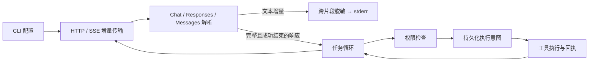

# 流式响应与模型协议

三种接口共用传输层、严格 JSON 校验和工具执行内核。协议适配器负责请求编码、增量聚合、结束状态校验与历史格式转换；模型只能提出操作，不能通过流式回调执行工具。

| 协议 | 文本增量 | 工具参数增量 | 成功结束 |
|---|---|---|---|
| Chat Completions | `choices[].delta.content` | 按 `tool_calls[].index` 聚合 | 合法 `finish_reason` 加 `[DONE]` |
| Responses | `response.output_text.delta` | 按 `output_index` / `item_id` 聚合 | 匹配的完整 output items 与 `response.completed` |
| Messages | `content_block_delta` / `text_delta` | `input_json_delta.partial_json` | 内容块闭合、合法 `stop_reason` 与 `message_stop` |

SSE 接收不能假设一个网络块就是一个事件。解析器需要处理跨块 UTF-8/CRLF、注释、空行分隔、多行 data 和响应大小限制。错误响应不转发原文，避免网关回显认证信息。HTTP 重定向仍被禁用。

默认每次响应累计上限 4 MiB，SSE 单行/单事件上限 1 MiB；即使大量 keepalive 注释也计入累计限制。较大的 Responses 最终事件可能触及单事件上限，此时明确报错并停止该轮。

文本可在结束前显示，但显示内容不是最终结果或执行证据。若流不完整，该轮不产生工具动作；此前轮次已经完成的动作仍保留。协议错误不自动重试，以免重复操作。

Responses 会将原生输出项（包括后续推理所需的数据）随完整历史再次发送，不依赖 `previous_response_id` 或服务端存储。Messages 会把多个工具回执合并成 user 消息中的 `tool_result` 内容块，并保留 assistant 内容块的原始顺序与签名。推理块不作为 CLI 回答文本输出。

当前覆盖文本及本地 function tools。内置搜索/托管工具、多模态输入、推理预算与 beta 参数、后台响应、断线续传和自动恢复不在本次范围。Windows 为实测平台；POSIX 传输实现仍需跨平台 CI 验证。测试采用本地 HTTP 服务，不代表所有模型和第三方网关均已实测。

协议依据（2026-10-21 核对）：

- [OpenAI Streaming responses](https://developers.openai.com/api/docs/guides/streaming-responses)
- [OpenAI Function calling](https://developers.openai.com/api/docs/guides/function-calling)
- [Anthropic Streaming Messages](https://platform.claude.com/docs/en/build-with-claude/streaming)
